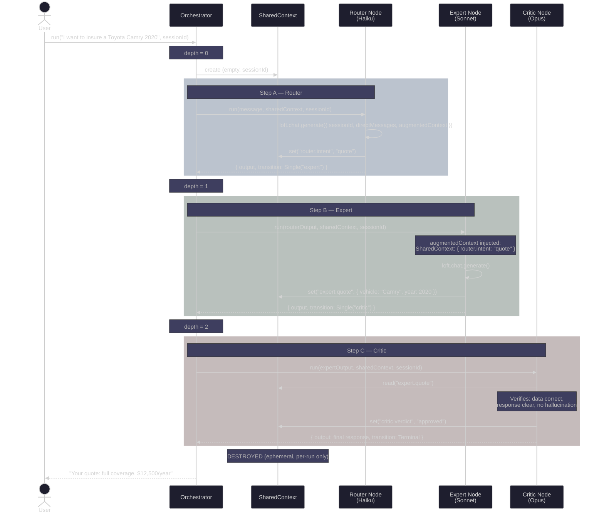
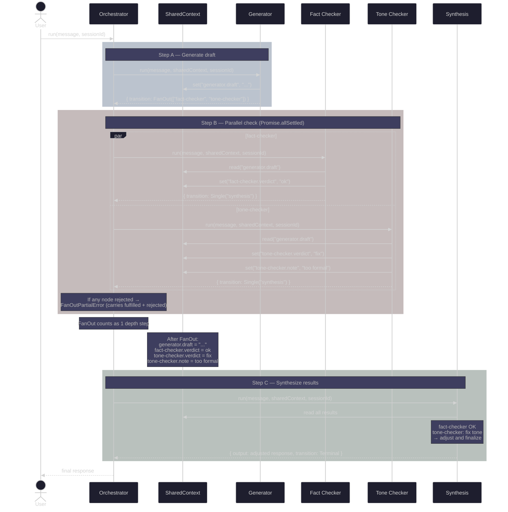
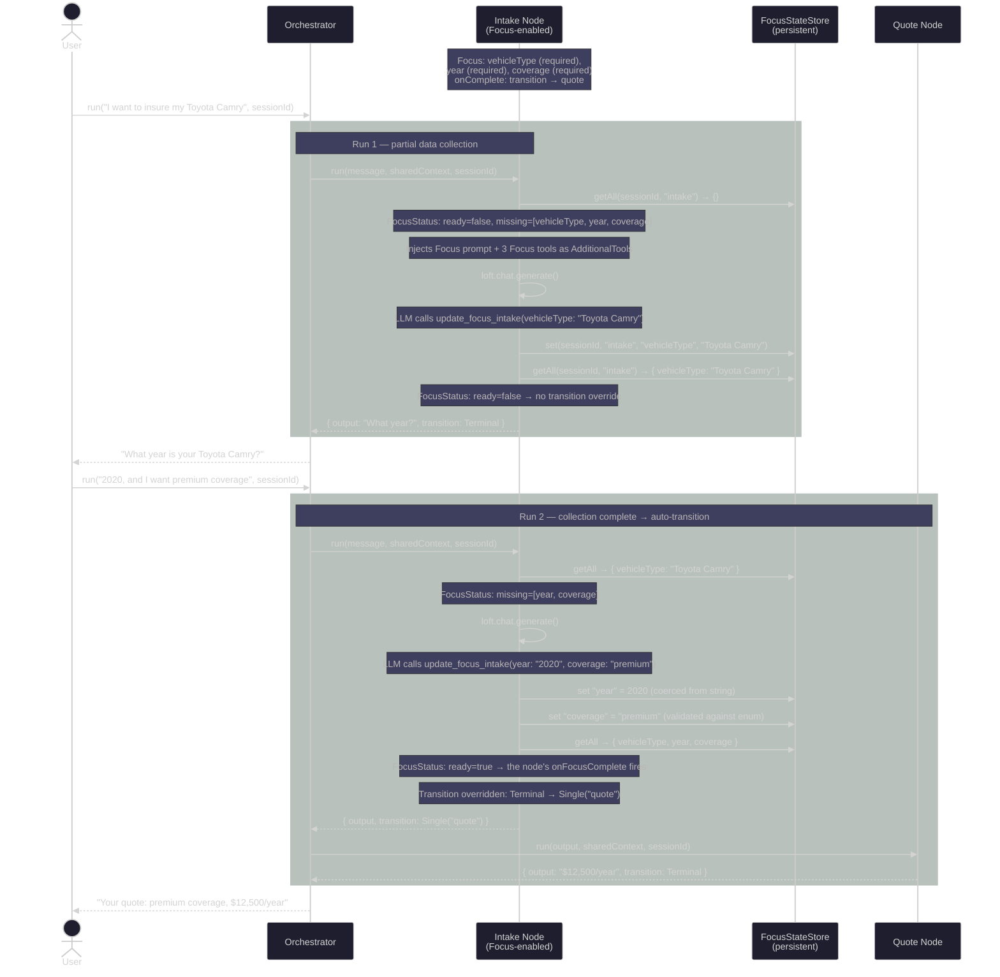
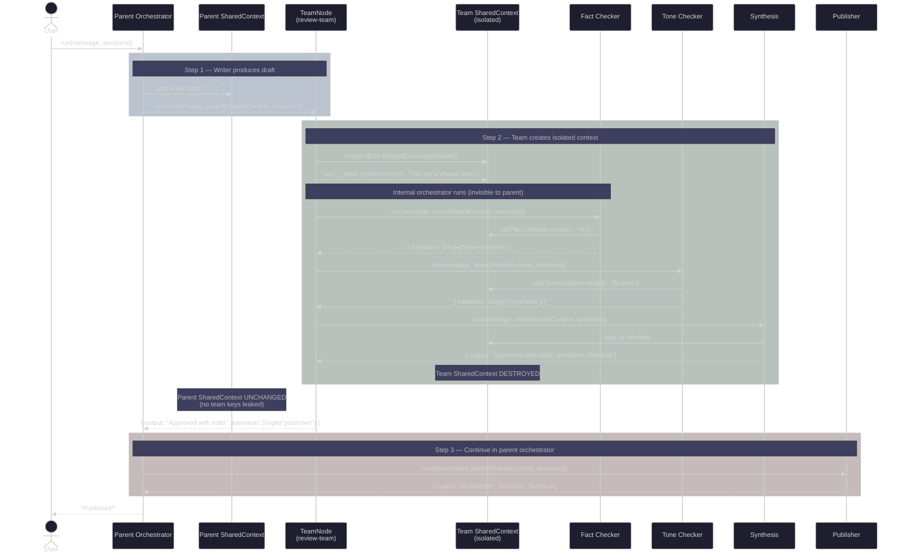
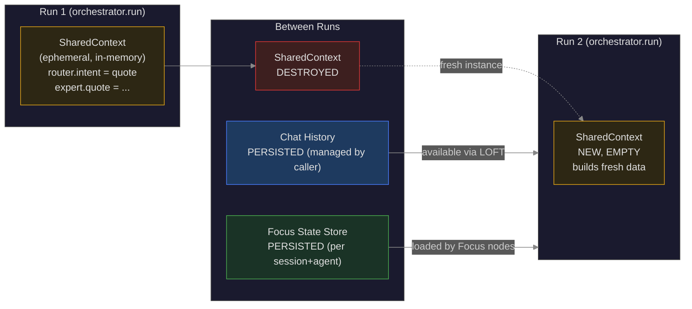
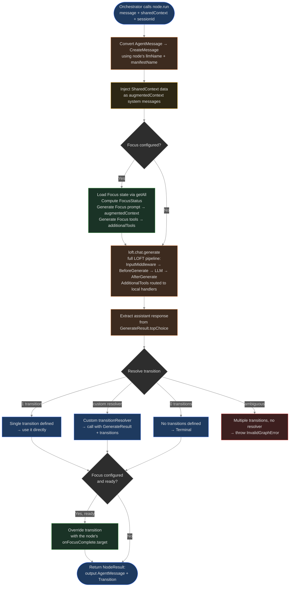
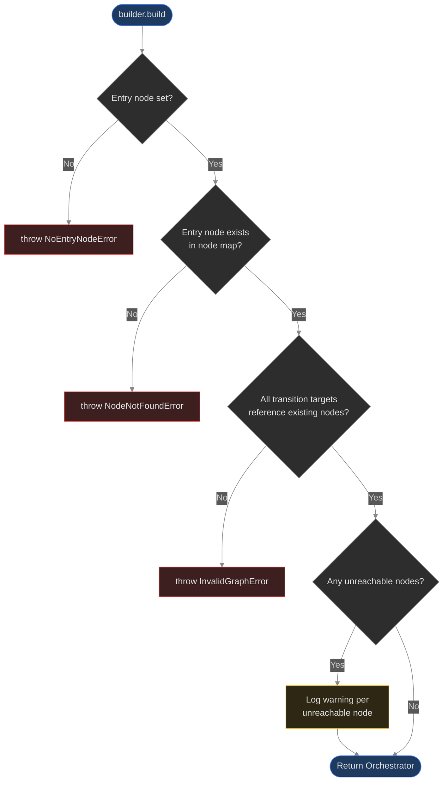
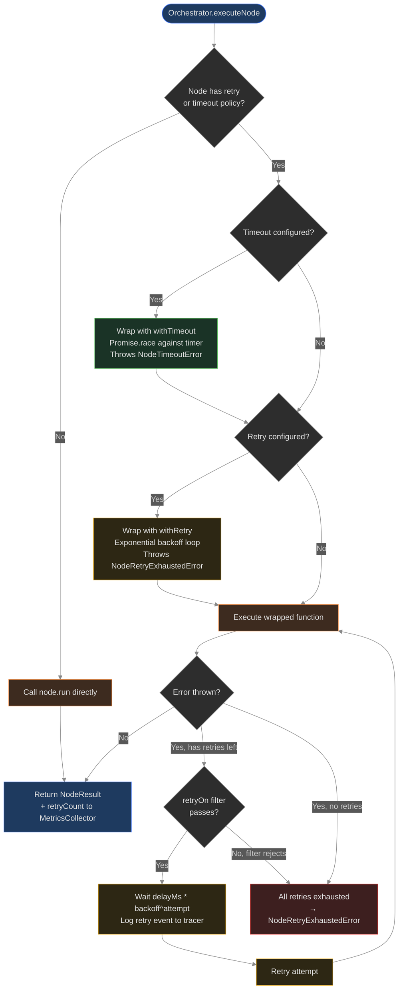

# Agent Orchestration — Flow Diagrams

> These diagrams reflect the **current implementation** (Phase 1 Core + Phase 2 Focus + Phase 3 Team + Phase 4 Hardening).

## 1. Sequential Chain: Router → Expert → Critic

## 2. Parallel Flow (FanOut)

## 3. Focus Multi-Turn Collection Flow

## 4. Team Execution (Encapsulated Sub-Graph)

**Key properties:**
- Team creates a **fresh SharedContext** — parent context is never passed in
- Team system prompt is stored in internal context as `__team.systemPrompt`
- Parent SharedContext has **zero modifications** after team runs
- Only the final `NodeResult` surfaces to the parent orchestrator
- Teams can be **nested** — a team inside a team gets triple context isolation

## 5. Data Lifecycle

**Key:** SharedContext is destroyed after each `orchestrator.run()`. Chat History is managed by the caller. Focus State Store persists across runs — Focus nodes load their state at the start of each run and write updates during tool execution.

## 6. LoftAgentNode Execution Detail

## 7. OrchestratorBuilder Validation

**Note:** Duplicate node names are caught eagerly in `addNode()` (throws `InvalidGraphError`), not at build time.

## 8. Node Policy Wrapping (Phase 4)

**Composition order:** timeout wraps `node.run()` (per attempt), retry wraps the timeout. Each retry attempt gets a fresh timeout. `retryOn` filter can exclude specific errors from retry.
