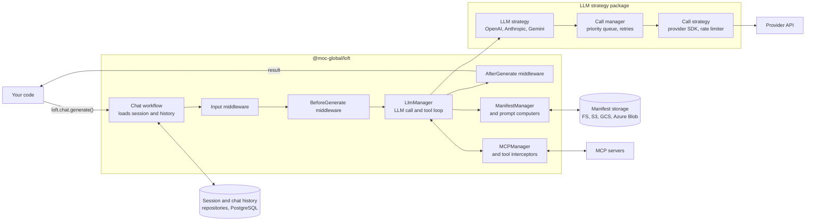

# Architecture

This page describes the overall system design of the LOFT monorepo: how packages are organized, how they depend on each other, and what each tier does.

## Package Tiers

LOFT is organized in layers where each tier depends only on tiers below it.

```
┌─────────────────────────────────────────────────────────────────────────┐
│  TIER 4 — INTEGRATION TESTS (private)                                   │
│                                                                         │
│  loft-integration-tests                                                 │
│  End-to-end tests using PGLite. Depends on everything.                  │
└───────────────────────────────────┬─────────────────────────────────────┘
                                    │
┌───────────────────────────────────▼─────────────────────────────────────┐
│  TIER 3 — PLUGGABLE STRATEGIES                                          │
│                                                                         │
│  LLM Providers:                                                         │
│  ┌──────────────────┐ ┌──────────────────┐ ┌──────────────────┐         │
│  │ loft-anthropic-  │ │ loft-openai-     │ │ loft-gemini-     │         │
│  │ strategy         │ │ strategy         │ │ strategy         │         │
│  └──────────────────┘ └──────────────────┘ └──────────────────┘         │
│                                                                         │
│  Manifest Storage Backends:                                             │
│  ┌────────────────┐ ┌──────────────────┐ ┌─────────────────────┐        │
│  │ loft-aws-s3-   │ │ loft-gcp-storage-│ │ loft-azure-blob-    │        │
│  │ repository     │ │ repository       │ │ storage-repository  │        │
│  └────────────────┘ └──────────────────┘ └─────────────────────┘        │
│                                                                         │
│  Queue: loft-queue-sqs-strategy                                         │
│                                                                         │
│  Agents: loft-agents (multi-agent orchestration; also depends on loft)  │
│                                                                         │
│  All Tier 3 packages depend on: loft-definitions                        │
└───────────────────────────────────┬─────────────────────────────────────┘
                                    │
┌───────────────────────────────────▼─────────────────────────────────────┐
│  TIER 2 — DATA & CALL MANAGEMENT                                        │
│                                                                         │
│  ┌────────────────────────────┐  ┌────────────────────────────┐        │
│  │ loft-session-pg-repository │  │ loft-chat-history-pg-      │        │
│  │ (Kysely, pg, migrations)   │  │ repository                 │        │
│  └────────────────────────────┘  └────────────────────────────┘        │
│                                                                         │
│  ┌────────────────────────────┐  ┌────────────────────────────┐        │
│  │ loft-llm-call-manager      │  │ loft-kysely-pg-migrator    │        │
│  │ (p-queue, tiktoken)        │  │ (private, shared migrator) │        │
│  └────────────────────────────┘  └────────────────────────────┘        │
│                                                                         │
│  All Tier 2 packages depend on: loft-definitions                        │
└───────────────────────────────────┬─────────────────────────────────────┘
                                    │
┌───────────────────────────────────▼─────────────────────────────────────┐
│  TIER 1 — CORE FRAMEWORK                                                │
│                                                                         │
│  ┌────────────────┐  ┌────────────────────────────────────────┐        │
│  │ loft-definitions│  │ loft (LoftConstructor, LOFT,           │        │
│  │ (types, DI,     │  │      ChatConstructor, LlmManager,     │        │
│  │  interfaces,    │  │      ManifestManager, MCPManager)      │        │
│  │  Logger, Schema)│  │                                        │        │
│  └────────────────┘  └────────────────────────────────────────┘        │
└───────────────────────────────────┬─────────────────────────────────────┘
                                    │
┌───────────────────────────────────▼─────────────────────────────────────┐
│  TIER 0 — CONFIGURATION & TEST UTILITIES (private)                      │
│                                                                         │
│  loft-base-tsconfig    Shared TypeScript config (ES2022, strict,        │
│                        decorators for Inversify)                        │
│  loft-pglite           In-process PostgreSQL for unit tests             │
│  loft-test-suite       Mock/spy logger utilities                        │
└─────────────────────────────────────────────────────────────────────────┘
```

## All Packages

Some packages have npm names that differ from their directory names. This table is the authoritative reference.

### Published Packages

| npm Package | Directory | Purpose |
|-------------|-----------|---------|
| `@moc-global/loft` | `packages/loft/` | Core framework: LoftConstructor, LOFT, ChatConstructor, managers |
| `@moc-global/loft-definitions` | `packages/loft-definitions/` | Types, interfaces, DI symbols, Logger, Zod schemas, middleware types |
| `@moc-global/loft-anthropic-strategy` | `packages/loft-anthropic-strategy/` | Anthropic Claude LLM strategy |
| `@moc-global/loft-openai-strategy` | `packages/loft-openai-strategy/` | OpenAI + Azure OpenAI LLM strategy |
| `@moc-global/loft-gemini-strategy` | `packages/loft-gemini-strategy/` | Google Gemini / Vertex AI LLM strategy |
| `@moc-global/loft-llm-call-manager` | `packages/loft-llm-call-manager/` | Rate limiting, retry, token counting (p-queue, tiktoken) |
| `@moc-global/loft-session-pg-repository` | `packages/loft-session-pg-repository/` | PostgreSQL session storage (Kysely). CLI: `loft-session-pg-migrate` |
| `@moc-global/loft-chat-history-pg-repository` | `packages/loft-chat-history-pg-repository/` | PostgreSQL chat history (Kysely). CLI: `loft-chat-history-pg-migrate` |
| `@moc-global/loft-aws-s3-repository` | `packages/loft-manifest-s3-strategy/` | AWS S3 manifest storage |
| `@moc-global/loft-gcp-storage-repository` | `packages/loft-manifest-gcp-storage-repository/` | Google Cloud Storage manifest storage |
| `@moc-global/loft-azure-blob-storage-repository` | `packages/loft-azure-blob-repository/` | Azure Blob manifest storage |
| `@moc-global/loft-queue-sqs-strategy` | `packages/loft-queue-sqs-strategy/` | AWS SQS queue for distributed call management |
| `@moc-global/loft-agents` | `packages/loft-agents/` | Multi-agent orchestration: nodes, teams, focus, orchestrator |

### Private Packages (not published to npm)

| npm Package | Directory | Purpose |
|-------------|-----------|---------|
| `@moc-global/loft-base-tsconfig` | `packages/loft-base-tsconfig/` | Shared TypeScript configuration |
| `@moc-global/loft-pglite` | `packages/loft-pglite/` | In-process PostgreSQL for unit tests (no Docker) |
| `@moc-global/loft-test-suite` | `packages/loft-test-suite/` | Test utilities: mock/spy logger strategies |
| `@moc-global/loft-kysely-pg-migrator` | `packages/loft-kysely-pg-migrator/` | Shared Kysely migration infrastructure |
| `loft-integration-tests` | `integration/` | End-to-end integration tests |

## Dependency Graph

Every published package depends on `@moc-global/loft-definitions` for interfaces and types. Beyond that, the key relationships are:

```
                    ┌─────────────────────┐
                    │   Your Application  │
                    └──────────┬──────────┘
                               │ uses
                    ┌──────────▼───────────┐
                    │    @moc-global/loft  │
                    │  (LoftConstructor,   │
                    │   ChatConstructor,   │
                    │   ManifestManager)   │
                    └──────────┬───────────┘
                               │ depends on
                    ┌──────────▼───────────┐
                    │  loft-definitions    │
                    │  (interfaces, types, │
                    │   DI_TYPES, Logger)  │
                    └──────────┬───────────┘
                               │
          ┌────────────────────┼────────────────────┐
          │                    │                    │
  ┌───────▼───────┐  ┌────────▼────────┐  ┌─────────▼────────┐
  │ LLM Strategies│  │ Session & Chat  │  │ Call Manager     │
  │ (OpenAI,      │  │ History Repos   │  │ (rate limiting,  │
  │  Anthropic,   │  │ (PG OOTB, or    │  │  retry, tokens)  │
  │  Gemini)      │  │  custom impl)   │  │                  │
  └───────────────┘  └─────────────────┘  └──────────────────┘
                     ┌─────────────────┐
                     │ Manifest Storage│
                     │ (FS, S3, GCS,   │
                     │  Azure Blob)    │
                     └─────────────────┘
```

**Key design principle:** `@moc-global/loft` (core) never depends directly on any strategy or repository package. The dependency flows through interfaces defined in `loft-definitions`. This means you only install the packages you need — if you use Anthropic and S3, you don't need the OpenAI or Azure Blob packages.

## Runtime Components

How the parts work together when your code calls `loft.chat.generate()`:



- The **chat workflow** loads the session and chat history into a **context**, which every middleware, prompt computer and tool interceptor receives. The context also carries the request's **tracer**.
- **Middleware** runs in three stages around the LLM call; BeforeGenerate middleware can answer without calling the LLM.
- **LlmManager** gets the system message and model settings from the **ManifestManager**, calls the **LLM strategy** registered under the request's LLM name (the session's, unless overridden for the request), and runs tools through the **MCPManager** until the LLM stops asking for them.
- The strategy translates between LOFT's message format and the provider's, and sends the call through a **call manager**, which queues calls by priority and retries them. The **call strategy** makes the provider SDK call and applies token and request rate limits.
- The tracer records each step: middleware, prompt computers, LLM calls and tool calls. With no tracer configured, LOFT uses one that does nothing.

[Processing Pipeline](./processing-pipeline.md) walks through the same flow step by step.

## Core Components

### Inside `@moc-global/loft`

The core package contains constructors, managers, and the chat workflow:

**Constructors** (how you configure LOFT):
- `LoftConstructor` — Creates the main DI container, binds LOFT + LlmManager + FocusRegistry + TracerStrategy
- `ChatConstructor` — Builds the chat pipeline: session repo, chat history, middleware, MCP
- `ManifestManagerConstructor` — Configures manifest loading and caching
- `FsRepositoryConstructor` — Local filesystem storage for manifests (dev/non-production use)

**Managers** (runtime service coordination):
- `LlmManager` — Routes LLM calls to the correct registered strategy
- `ManifestManager` — Loads, caches, and resolves manifest files
- `ChatHistoryManager` — Manages conversation message storage and retrieval
- `MCPManager` — Handles MCP server connections and tool discovery
- `ToolInterceptorManager` — Intercepts and customizes MCP tool execution
- `ComputerManager` — Manages prompt computers (GM, ATM, Prompt)

**Workflows** (request processing):
- `BaseLoftChat` — The main chat workflow implementing `generate()`, `createSession()`, `addMessages()`
- `AbstractLoftChat` — Base class with shared session and history operations

### Inside `@moc-global/loft-definitions`

The foundation package defines all contracts:

- **`DI_TYPES`** — Inversify symbols for all injectable services
- **Interfaces** — `LlmManager`, `ManifestManager`, `ChatConstructor`, `ToolInterceptorManager`, MCP types
- **Strategy types** — `LoftLLM`, `CallManager`, `TracerFactory`, `LoftQueue`
- **Repository types** — `Session`, `ChatHistory`, `ChatHistoryPatcher`, `ObjectStorage`
- **Middleware types** — `StandardMiddleware`, `BeforeGenerateMiddleware`, `MiddlewareManager`
- **Schemas** — Zod schemas for `CreateMessage`, `ContentPart`, LLM types
- **Logger** — Pino-based logger with pluggable strategies (`PinoLoggerStrategy`)
- **`NativeCallManagerStrategy`** — In-process call manager wrapper (lives here because it implements `Strategy.CallManager`)

## Build Architecture

All packages use the same build toolchain:

- **tsup** — Bundles to dual ESM (`.mjs`) + CJS (`.js`) with sourcemaps
- **TypeScript** — Generates declarations (`.d.ts`) separately via `tsc -p tsconfig.declarations.json`; `scripts/emit-esm-types.mjs` then writes their ES module twins (`.d.mts`)
- **Turbo** — Orchestrates builds respecting the dependency graph (`^build` notation)

Build output goes to `lib/` in each package. The `exports` field in each `package.json` points to:
```json
{
  ".": {
    "import": { "types": "./lib/index.d.mts", "default": "./lib/index.mjs" },
    "require": { "types": "./lib/index.d.ts", "default": "./lib/index.js" }
  },
  "./package.json": "./package.json"
}
```

## What's Next

- **[Examples](../../examples/)** — Runnable applications showing how these tiers connect in practice
- **[Processing Pipeline](./processing-pipeline.md)** — How a request flows through LOFT step by step
- **[Dependency Injection](./dependency-injection.md)** — How Inversify wires everything together
- **[Strategy Pattern](./strategy-pattern.md)** — How LLM providers and storage backends are pluggable
