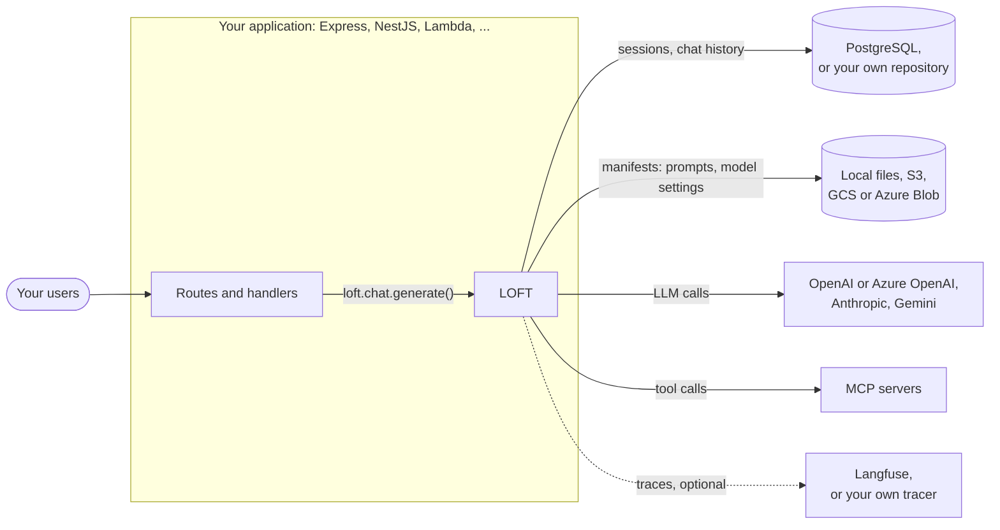

# Introduction to LOFT

## What is LOFT?

LOFT (LLM-Orchestrator Framework for TypeScript) is a backend framework for building applications powered by Large Language Models. It handles the complex infrastructure between your application code and LLM providers:

- **LLM orchestration** — Register multiple LLM providers (OpenAI, Anthropic, Gemini) and switch between them at runtime
- **Middleware pipeline** — Process requests before and after LLM calls with composable middleware
- **Session management** — Track conversations with persistent sessions. PostgreSQL is supported out of the box; you can also implement custom storage for any database by providing your own `SessionRepository` and `ChatHistoryRepository`
- **Chat history** — Automatically store and retrieve conversation history
- **Manifest system** — Separate prompt engineering from code via JSON configuration files
- **Tool integration** — Connect external tools via [Model Context Protocol (MCP)](https://modelcontextprotocol.io/), an open standard for LLM-to-tool communication
- **Observability** — Built-in tracing support (Langfuse or custom)

LOFT is **not** a standalone application. It is a framework you integrate into your own backend — whether that's Express, NestJS, Fastify, a serverless function, or any other Node.js runtime. LOFT is HTTP-framework agnostic; it doesn't handle routing, authentication, or HTTP concerns. You call LOFT from your request handlers.

## When to Use LOFT

LOFT is designed for **backend applications** that need to:

- Interact with one or more LLM providers through a unified interface
- Maintain conversation state (sessions, chat history) across requests
- Apply business logic before and after LLM calls (via middleware)
- Manage prompts and model settings separately from application code
- Handle rate limiting, retries, and token budgets for LLM API calls

If you're building a chatbot, a conversational AI backend, an agent system, or any service that makes LLM calls with conversation context, LOFT provides the infrastructure so you don't have to build it yourself.

## How LOFT Fits Into Your Application

LOFT is a library inside your backend, not a separate service. Your handlers call it, and it talks to the databases, storage and APIs you configure:

Inside LOFT, each request runs through Input middleware, BeforeGenerate middleware, the LLM call with its tool loop, and AfterGenerate middleware. [Architecture](../concepts/architecture.md#runtime-components) shows the components, and [Processing Pipeline](../concepts/processing-pipeline.md) the steps.

## Architecture at a Glance

LOFT is built on three core patterns:

### 1. Dependency Injection (Inversify)

All components are wired together through an Inversify DI container. You don't instantiate LOFT services directly — you configure constructors that tell LOFT how to build the dependency graph:

- **LoftConstructor** — The main entry point. Creates the DI container and binds core services.
- **ChatConstructor** — Configures the chat pipeline (session repo, chat history repo, middleware managers).
- **ManifestManagerConstructor** — Configures manifest storage (local filesystem, S3, GCS, or Azure Blob).

### 2. Strategy Pattern

LLM providers, storage backends, and call managers are all pluggable strategies. You pick the implementations you need:

- **LLM Strategies**: `@moc-global/loft-openai-strategy`, `@moc-global/loft-anthropic-strategy`, `@moc-global/loft-gemini-strategy`
- **Manifest Storage**: Local filesystem, AWS S3, GCP Storage, Azure Blob — used exclusively for storing manifest files (system prompts and model presets)
- **Session & Chat History Storage**: PostgreSQL is provided out of the box. You can implement `Repository.Session` and `Repository.ChatHistory` interfaces (from `@moc-global/loft-definitions`) to use any other database
- **Call Manager**: In-process rate limiting and retries (`@moc-global/loft-llm-call-manager`)

### 3. Middleware Pipeline

Every request passes through a configurable chain of middleware:

1. **Input Middleware** — Transform the incoming request
2. **BeforeGenerate Middleware** — Pre-process before the LLM call (can prevent generation)
3. **LLM Generate** — The actual LLM API call
4. **AfterGenerate Middleware** — Post-process the LLM response

Middleware is registered by name on the `ChatConstructor` and executes sequentially.

## What's Next

- **[Quickstart](./quickstart.md)** — Get a working LOFT instance in 15 minutes
- **[Examples](../../examples/)** — Runnable applications: Express, NestJS, and AWS Lambda
- **[Core Concepts](./core-concepts.md)** — Deeper dive into DI, strategies, pipeline, and manifests
